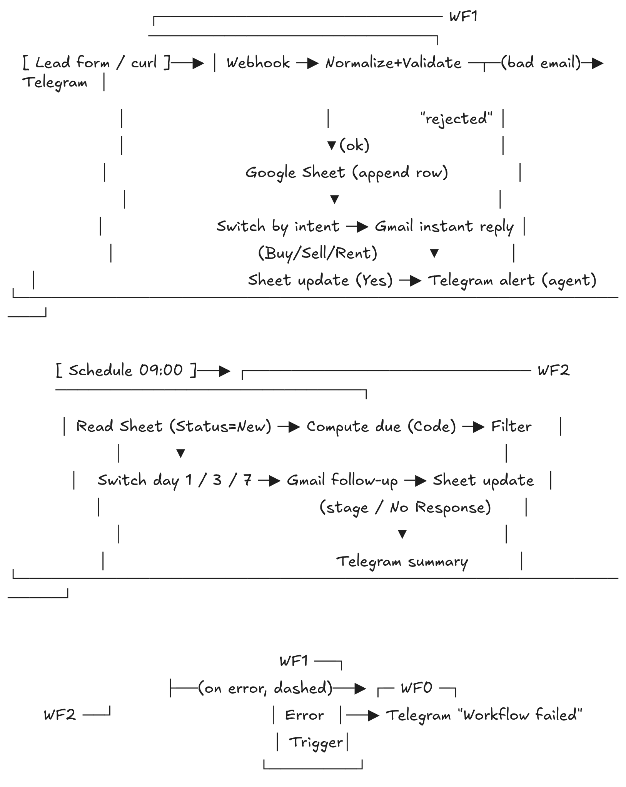

# Lead Follow-Up Automation

## What it does
This project automates the lead response process for real estate agents. When a new lead arrives, they receive a personalized instant reply within a minute based on their intent (Buy, Sell, or Rent). The agent receives an immediate Telegram alert. Unanswered leads are automatically nurtured with follow-up emails on day 1, day 3, and day 7. If a workflow fails, the agent is instantly notified via Telegram.

*Disclaimer: This is a demo project. All data, including the brokerage "Harbor & Pine Realty" and agent "Sam Carter", is entirely fictional.*

## Architecture

## Tools Used
- **n8n**: Main automation engine (self-hosted via Docker).
- **Google Sheets**: Acts as the demo CRM.
- **Gmail API**: Sends personalized instant replies and follow-ups.
- **Telegram Bot**: Delivers real-time alerts to the agent.
- **Git & GitHub**: Version control and repository hosting.

## Setup Instructions
1. Clone this repository.
2. Set up a self-hosted n8n instance using Docker (see `docs/setup.md` for detailed environment configuration).
3. Create the required OAuth credentials in Google Cloud Console and a Telegram Bot via @BotFather.
4. Add your credentials inside the n8n UI (named `Demo Gmail`, `Demo Google Sheets`, `Demo Telegram`).
5. Import the workflow JSON files from the `workflows/` directory into n8n. *Note: You will need to re-select your credentials and update the `YOUR_DOCUMENT_ID`, `YOUR_SHEET_ID`, and `YOUR_CHAT_ID` placeholders in the Google Sheets and Telegram nodes with your actual values.*
6. Create a Google Sheet named "Leads Demo" with the columns defined in `data/sheet-columns.md`.

## Test Plan
A comprehensive test plan covering all edge cases (valid leads, invalid emails, missing data, duplicate submissions, and error handling) is documented in [docs/test-plan.md](docs/test-plan.md). All tests have been executed and passed.

## Demo
- **Live Demo Sheet**: [View-only Google Sheet](https://docs.google.com/spreadsheets/d/YOUR_DOCUMENT_ID/edit?usp=sharing) *(Replace YOUR_DOCUMENT_ID with the actual ID before publishing)*
- **Video Walkthrough**: [Loom Demo Video](YOUR_LOOM_LINK_HERE) *(To be added in Milestone 9)*

## Case Study
A detailed breakdown of the pain point, solution, and estimated impact can be found in [docs/case-study.md](docs/case-study.md).
